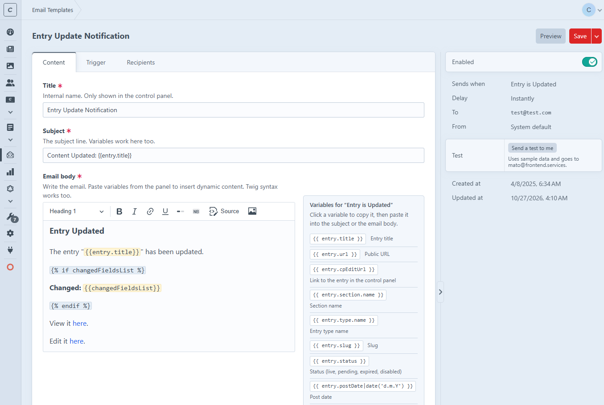

# MailCraft for Craft CMS

> **Client friendly email notifications**

MailCraft allows content managers to set up email notifications directly from the Craft CMS control 
panel - no developer assistance required. Install once, and let your clients handle the rest.

## What's New 🚀

- **Compatible with V5 CKEditor plugin version**: MailCraft now works seamlessly with the latest CKEditor plugin for Craft CMS.
- **Full CKEditor toolbar builder**: Choose from all available CKEditor toolbar options when configuring your email templates.

## Key Features

- **Visual Email Builder**: Create beautiful email templates using familiar Twig syntax
- **Event-Driven Triggers**: Configure emails to send automatically based on specific system events
- **Scheduled Delivery**: Set up delayed emails for follow-ups, reminders, and nurture campaigns
- **Conditional Logic**: Target specific users or content with powerful filtering options
- **Zero Code Required**: All configuration happens in the admin interface

## Event Triggers & Notification Types

MailCraft supports various event types to help you automate your notifications:

### Content Events
- **Entry Created** - Send notifications when new content is published
- **Entry Updated** - Alert team members when existing content changes
- **Filtering** - Target by section, entry type, status, field values, and more

### User Management
- **User Created** - Welcome new registrations automatically or notify admins
- **User Updated** - React to profile changes or important user updates
- **User Activated** - Send onboarding materials when accounts become active
- **Email Verified** - Acknowledge successful verification steps
- **Filtering** - Target by user group, custom fields, and more

### E-Commerce
- **Order Created** - Notify users when they place an order or alert admins
- **Order Status Changed** - Alert users when their order status changes

### System Notifications
- **Updates Available** - Get notified when a new version of Craft CMS or 
plugins is available. Optionally trigger only on critical updates
- **Failed Queue Job** - Notify admins when a queue job fails

### Missing an Event? ⚠️

If you need a specific event that isn't currently supported, please let us know! Give us a shout at 
[mailcraft.dev](https://mailcraft.dev) or open an issue on GitHub.

## Feature Requests & Contributions

We're actively developing MailCraft and welcome community input:

- **Issues & Requests**: [Open an issue on GitHub](https://github.com/frontend-services/craft-mailcraft/issues)
- **Contact**: Reach out at [mailcraft.dev](https://mailcraft.dev)
- **Contribute**: Pull requests welcome for features that benefit the community

## Roadmap

- More Event Types
- CKEditor Toolbar Customization
- Twig variable suggestions
- Improved admin UI/UX