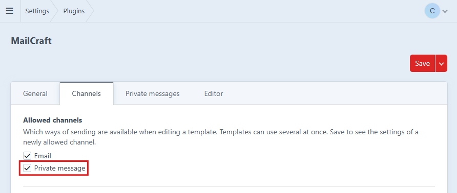
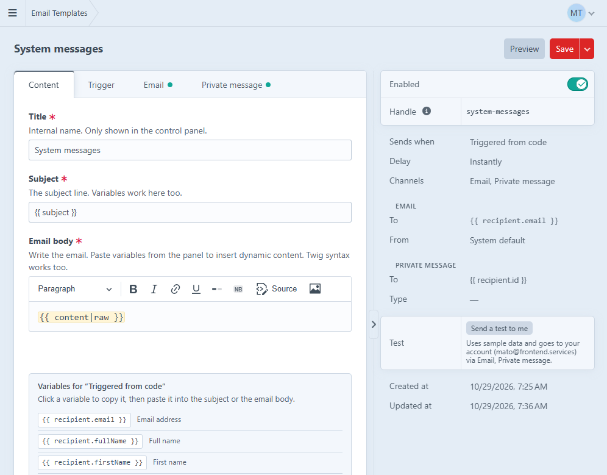
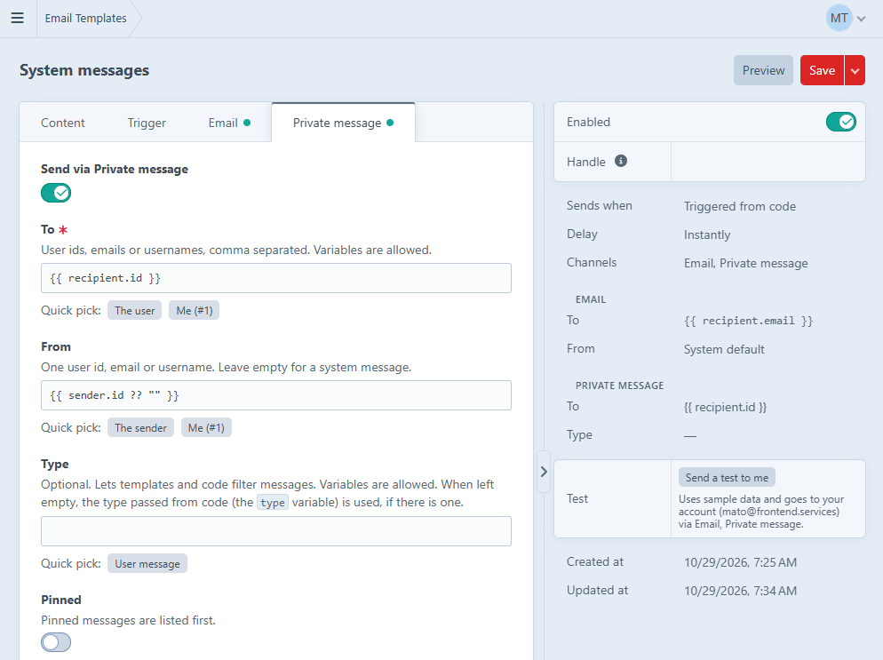

# Private messaging on Craft CMS: setup guide

Private messages are a [MailCraft](https://plugins.craftcms.com/mailcraft) channel. The plugin ships working demo templates (inbox, single message with reply, sent list, send form, unread badge) in its `examples/templates/messages/` folder; section 4 explains how to install them and what each file shows.

This channel can also be used for other type of messages like system messages, store promotions, service disruptions and similar.

## 1. Enable the channel

Settings -> MailCraft -> Channels tab -> Allowed channels: enable **Private message** and save. The "Private messages" tab appears on the settings page once the channel is allowed.



## 2. Configure message types (optional)

We can define different message types, for example `user`, `system`, `info`, ... `user` type is used by default by plugin functions for private message sending, unless otherwise specified.

`config/mailcraft.php` can override any of these settings like any Craft plugin setting. `privateMessageTypes` accepts label => value or a plain list:

```php
return [
    'privateMessageTypes' => ['User message' => 'user', 'System message' => 'system', 'Info' => 'info'],
    // or: 'privateMessageTypes' => ['user', 'system', 'info'],
];
```

Even without defining message types in settings we can still add custom types when sending messages. The only thing we lose is the type label that can be defined this way.

## 3. A template with the channel enabled on a normal event (optional)

Create an email template, pick its event, and enable the Private message channel tab. Use the quick picks for the fields:

- To: `{{ recipient.id }}`
- From: `{{ sender.id ?? "" }}`
- Type: one of your type values

Give the template a handle in its sidebar. Each time the event fires, the message is written for the recipient.

## 4. Frontend twig templates

The plugin ships a working demo frontend templates for private messages. The files live in `examples/templates/messages/` inside the plugin folder (`vendor/frontend-services/craft-mailcraft/examples/templates/messages/`). They are plain Twig with Tailwind classes (loaded from a CDN, demo only).

1. Copy the whole folder to `templates/messages/` in your project. Keep the file names: the templates extend and include each other by path (`messages/_layout`, `messages/_badge`, `messages/_message`).
2. Add one route in `config/routes.php`, so `/messages/123` opens a single message:

   ```php
   return [
       'messages/<id:\d+>' => ['template' => 'messages/show'],
   ];
   ```

   `/messages`, `/messages/sent` and `/messages/send` need no route: Craft matches them to `index.twig`, `sent.twig` and `send.twig` by path.
3. Log in on the frontend and open `/messages`. Send yourself a message from the control panel ("Send a test to me" on a template with the Private message channel enabled) or from PHP (section 5) to have something to look at.

The "New message" page and the reply form only work when **Allow sending from the frontend** is on (section 9). Everything else works out of the box.

### What each file does

| File | Role | API it shows |
|---|---|---|
| `_layout.twig` | Page frame: nav (Inbox, Sent, New message), the badge, and flash messages. | The controller actions redirect back and leave a Craft flash message in the session (`success` for "Message sent." / "Updated.", `error` for a refused send) |
| `_badge.twig` | Unread counter, rendered only when the user has unread messages. | `craft.mailCraft.unreadTotal()` |
| `index.twig` | List of received messages with message actions. | `craft.mailCraft.messages()` |
| `_message.twig` | Single message, included by `show.twig`. | `message`, `content` |
| `show.twig` | Loads the message from the URL id and shows the reply form. | `craft.mailCraft.message(id)`, `craft.mailCraft.sentMessage(id)` |
| `sent.twig` | List of sent messages. | `craft.mailCraft.sentMessages()` |
| `send.twig` | New message form. | POST to `mailcraft/messages/send` |


## 5. Sending from PHP (for building a custom messaging system)

### Template event

When building a new MailCraft template in the admin there is a manual event called **Triggered from code**. It never fires by itself, a template on it is only sent when your code calls `MailCraft::send()` or `PrivateMessaging::send()`, and the call supplies the required variables. A template on it can have the Private message channel, the Email channel, or both enabled.




| Variable | Meaning |
|---|---|
| `recipient` | The user the message is for (`craft\elements\User` element) |
| `sender` | The sending user (`craft\elements\User` as well, or empty for a system message) |
| `subject` | The subject passed from code |
| `content` | The content passed from code. Print it with `{{ content|raw }}` |
| `type` | The message type passed from code |

The example loaded by "Load example email for this event" has the subject `{{ subject }}` and the body `{{ content|raw }}`, which is also what the built-in simple message uses. Any extra keys you pass in the variables array reach the template under their own names.

Using a template, by handle, id or element:

```php
\frontendservices\mailcraft\MailCraft::send('system-messages', ['recipient' => $user]);
```

The template's event and conditions are not consulted, so the template can be on "Triggered from code" or on any other event, it would still send the message using it's enabled channels.

Without a template (uses the built-in simple message, or the template named by `privateMessageTemplate`):

```php
\frontendservices\mailcraft\PrivateMessaging::send('Welcome', '<p>Hello!</p>', [
    'to' => $user,
    'type' => 'system',
]);
```

### List of all options

| Option | Meaning |
|---|---|
| `to` | Required. User, id, or a list of those; several recipients make several messages |
| `from` | Sender (user, id, or null) |
| `type` | A type value |
| `pinned` | bool |
| `expires` | DateTime, number of days, or null |
| `meta1` ... `meta5` | Strings for your own use, max length 255. Can be used for filtering messages |
| `data` | Array stored with the message. In database it is stored as JSON in a `TEXT` column |
| `variables` | Extra Twig variables for the template |
| `template` | Handle, id or element. Overrides `privateMessageTemplate` |
| `site` | Site, id or handle to render in |
| `delay` | Seconds |

`PrivateMessaging` also has `query()`, `markRead()`, `setPinned()`, `setHidden()` and `delete()` functions.

## 6. Content overrides

A template has one subject and body (the Content tab) that every channel sends. A channel can send something else instead, for example the full text as a private message and only "You have a new message on {{ siteName }}" by email.

## 7. Reference

### `craft.mailCraft`

| Method | Returns |
|---|---|
| `messages(user = null)` | `MessageQuery`; null = current user, a guest gets an empty result |
| `total(user = null)` | int |
| `unreadTotal(user = null)` | int |
| `message(id, user = null)` | `Message` or null |
| `sentMessages(user = null)` | `MessageQuery` of what the user sent, newest first, hidden and expired included; a guest gets an empty result |
| `sentMessage(id, user = null)` | `Message` or null |
| `messageTypes()` | `value => label` |

###  `MessageQuery` (`craft.mailCraft.messages()`)

| Method | Effect |
|---|---|
| `to(user)`, `from(user)` | Filter by recipient or sender |
| `sentBy(user)` | Filter by sender for a "sent" listing |
| `type(value)` | Filter by type |
| `unread()`, `read()` | Filter by read state |
| `pinned()` | Only pinned |
| `hidden()` | Only hidden |
| `withHidden()` | Include hidden messages (hidden are excluded by default) |
| `withExpired()` | Include expired messages (excluded by default) |
| `meta(n, value)` | Filter by `meta1` ... `meta5` |
| `id(id)` | Filter by id |
| `limit()`, `offset()`, `orderBy()` | As in Yii; default order is pinned first, then newest |
| `count()`, `all()`, `one()` | Run the query |

### `Message` properties

| Property | Description |
|---|---|
| `id` | Message id |
| `subject` | Subject line |
| `content` | Message body |
| `type` | Raw type handle, or null |
| `typeLabel` | Type label from the plugin settings, else the raw type (empty string when there is no type) |
| `pinned` | Whether the message is pinned |
| `hidden` | Whether the message is hidden |
| `isRead` | Whether the recipient has read it (`dateRead` is set) |
| `isExpired` | Whether `dateExpires` has passed |
| `dateCreated` | When the message was sent |
| `dateRead` | When it was read, or null |
| `dateExpires` | When it expires, or null for never |
| `from` | Sender as a `craft\elements\User` (disabled and soft-deleted users still load), or null for a system message or a permanently deleted sender |
| `to` | Recipient as a `craft\elements\User` (disabled and soft-deleted users still load); permanently deleting the recipient deletes their messages |
| `fromId`, `toId` | Raw sender and recipient ids (`fromId` is null for a system message or a permanently deleted sender) |
| `meta1` ... `meta5` | Indexed string fields you can filter on with `meta(n, value)` |
| `data` | Array of extra values |

`from` and `to` are full user elements, so `message.from.friendlyName`, `message.to.email` and any user field are available.

### Controller actions

All POST, logged-in users only, CSRF required. Post `id` or `ids[]`. Each action only touches the current user's own messages, other ids are ignored. JSON responses carry `updated` and `ignored` counts.

| Action | Effect |
|---|---|
| `mailcraft/messages/mark-read` | Mark read |
| `mailcraft/messages/mark-unread` | Mark unread |
| `mailcraft/messages/mark-all-read` | Mark all of the user's messages read |
| `mailcraft/messages/pin`, `unpin` | Pin or unpin |
| `mailcraft/messages/hide`, `unhide` | Hide or unhide |
| `mailcraft/messages/delete` | Delete permanently |
| `mailcraft/messages/send` | Send a message (see below); body `to`, `subject`, `content` |

`send` failure messages:

| Message | When |
|---|---|
| Too many messages. Please try again later. | Hourly limit reached |
| Recipient not found. | Unknown or inactive user |
| Subject is required. | Empty subject |
| Message is empty. | Empty content after purifying |
| Message is too long. | Over 100,000 characters as posted, or over 20,000 after purifying |
| You can't send a message to this user. | Refused by `EVENT_BEFORE_FRONTEND_SEND` |
| The message could not be sent. | Sending failed |

With `allowFrontendSending` off, `send` answers 403.

## 8. Frontend sending

`examples/templates/messages/send.twig` lets a logged-in user message another user through `mailcraft/messages/send`. It is off by default.

| Setting | Default | Meaning |
|---|---|---|
| `allowFrontendSending` ("Allow sending from the frontend") | `false` | Allow the `send` action |
| `frontendSendingPerHour` ("Frontend sending limit") | `30` | Messages one user may send per hour; `0` = unlimited |
| `frontendSendingType` ("Frontend message type") | `user` | `type` written on these messages. A posted `type` is ignored. A template whose Type field is blank takes this value; a template with its own Type overrides it |

- **Rate limit.** A per-user counter in Craft's cache with a one-hour window. If the cache is a `yii\caching\DummyCache` the counter cannot persist, so MailCraft counts the user's sent rows from the last hour instead - stored private messages with `fromId` = the sender. System and template sends are never limited.
- **Content.** Subject is plain text, trimmed to 255 characters. Content over 100,000 characters is refused before purifying; after purifying to a small allowlist of tags it is refused above 20,000 characters.

## 9. Block message sending using the event
A site module can refuse a message before it is sent. This can be useful for setting extra rules for sending private messages.

```php
use frontendservices\mailcraft\controllers\MessagesController;
use frontendservices\mailcraft\events\FrontendSendEvent;
use yii\base\Event;

Event::on(MessagesController::class, MessagesController::EVENT_BEFORE_FRONTEND_SEND, function(FrontendSendEvent $e) {
    // Example rule: only members of the "members" user group may send messages.
    if (!$e->from->isInGroup('members')) {
        $e->isValid = false;
    }
});
```

`$e->from` is the sending user and `$e->to` the recipient; `subject` and `content` may be rewritten. The controller does not validate rewritten values again; the service still purifies the content and trims the subject to 255 characters when it saves the message. (Yii's own `$sender` is the controller.)
